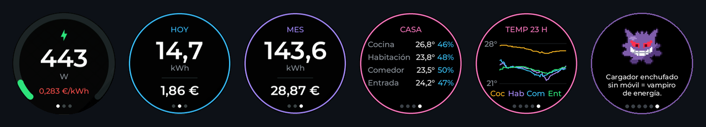
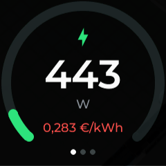
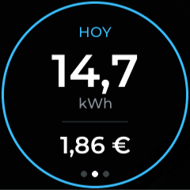
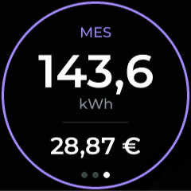
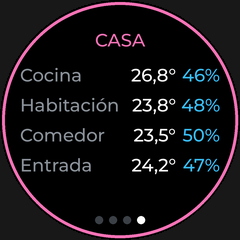
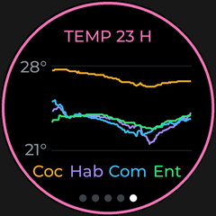
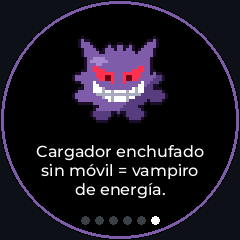
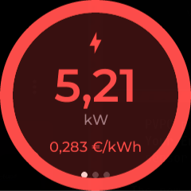

<div align="center">

**English** · [Español](README.md)

# ⚡ Round Energy Display

**A tiny 240×240 px home dashboard: live power usage, today's and this month's cost,
the temperature of every room… and a Gengar that gives you energy-saving tips.**




</div>

---

## ✨ What it does

- **Live power** on a gauge that goes from green to amber to red as your usage rises.
- **Electricity price** for the current hour, coloured by whether it is one of the cheap or expensive hours of the day.
- **Today's and this month's kWh and €**, worked out on the device itself and saved to flash so they survive a power cut.
- **Temperature and humidity** of every room, plus a **graph of the last 24 h**.
- **Alert**: when you get close to your contracted power, the screen wakes up on its own and flashes red.
- **Gengar** 👻 floats, winks, sticks his tongue out and hands out energy-saving tips (some react to the current price and usage).

## 📱 Screens

A **tap** shows the next page and a **vertical swipe** turns the screen 180° (remembered after a restart).
After 15 s without a touch it goes back to the main page.

| | | |
|:---:|:---:|:---:|
| <br>**Now**<br>power and price | <br>**Today**<br>kWh and € today | <br>**Month**<br>kWh and € this month |
| <br>**Home**<br>temperature and humidity | <br>**Graph**<br>last 24 h | <br>**Gengar**<br>tips with a grin |

<sub>The on-screen texts are in Spanish by default; they can be translated in a few lines (see section E below).</sub>

<details>
<summary>🚨 Alert mode</summary>
<br>
<div align="center"></div>

Above `power_alert_on_w` (5000 W) the screen wakes up, jumps to the power page
and flashes red until the power drops below `power_alert_off_w` (4800 W).
</details>

## 👻 Gengar


32×32 pixel art, hand-drawn (in code) and painted 3× bigger on an LVGL canvas.
It is only animated while its page is visible, so it costs no CPU the rest of the time.

The tip changes every 7 s. One in three depends on what is happening right now:

- 🟢 cheap price → *"Cheap power now! Start the washing machine, hee hee."*
- 🔴 expensive price → *"Pricey power! Leave the oven for later or I'll scare you."*
- ⚡ high usage → *"Look at you spending! Even I'm scared."*

The tips (in Spanish) live in the `gengar_tip` script of [`pantalla.yaml`](pantalla.yaml). Replace them with
your own in any language; if they use new letters, add those to the `glyphs` of `font_tip`.

<br clear="right">

## 🔧 Hardware

| Part | Details |
|---|---|
| Board | ESP32-C3 (`esp32-c3-devkitm-1`) |
| Display | GC9A01A round 240×240, SPI (CLK `GPIO6`, MOSI `GPIO7`, CS `GPIO10`, DC `GPIO2`) |
| Touch | CST816 over I²C (SDA `4`, SCL `5`, INT `0`, RST `1`) |
| Backlight | PWM on `GPIO3`, controllable from Home Assistant |

It is the common 1.28" "ESP32-C3 round display" board.

## 🛠️ Make it yours

Everything you need to change is at the top of [`pantalla.yaml`](pantalla.yaml), under `substitutions`,
split into sections and commented in English and Spanish. **Nothing else has to be touched.**

**B · Energy.** Your power, energy and price sensors:

```yaml
entity_power: sensor.my_meter_power        # W, live
entity_energy: sensor.my_meter_energy      # kWh, ever-growing meter reading
entity_price: sensor.esios_pvpc            # €/kWh (Spanish PVPC integration)
price_ratio_attribute: price_ratio         # 0 = cheapest hour, 1 = most expensive
```

If your price sensor has no `price_ratio`, the price is simply shown in grey and everything else works.
Any price sensor in currency/kWh will do.

**C · Rooms.** Name, short name for the graph legend, and sensors:

```yaml
room1_name: "Kitchen"
room1_short: "Kit"
room1_temp: sensor.kitchen_temperature
room1_hum: sensor.kitchen_humidity
```

Fewer than four? Search the file for `[room4]` and delete the marked blocks (then `[room3]`…).

**D · Power thresholds** for your contracted power:

```yaml
power_green_max_w: "1800"   # green below
power_amber_max_w: "3600"   # amber below, red above
power_gauge_max_w: "5500"   # full scale of the gauge
power_alert_on_w:  "5000"   # start flashing
power_alert_off_w: "4800"   # stop flashing
```

**E · Texts and format.** Translate the titles here and set your currency and decimal separator:

```yaml
txt_today: "TODAY"
txt_month: "MONTH"
txt_rooms: "HOME"
txt_graph_now: "NOW"
currency: "€"
decimal_sep: "."
```

**F, H · Behaviour and colours.** Time before going back to the main page, graph samples,
Gengar's speed and every colour (`col_*`).

**I · First boot.** Leave it at `0` and the counters start from the first reading. If you want
the day and month to be right from the start, put your meter readings there.

### How `pantalla.yaml` is organised

| Section | Contents |
|---|---|
| `substitutions` | **All your settings** (A–I) |
| 1 · Core | Wi-Fi, API, OTA, time |
| 2 · Hardware | Display, touch and backlight with their pins |
| 3 · Data | Sensors read from Home Assistant |
| 4 · State | Counters saved to flash and helper functions |
| 5 · Logic | kWh and € maths, alert, graph, Gengar animation |
| 6 · Fonts | Typefaces and the characters they include |
| 7 · Interface | The six LVGL pages |

## 🚀 Build and flash

You need a `secrets.yaml` with `wifi_ssid` and `wifi_password`.

**With plain ESPHome:**

```bash
esphome run pantalla.yaml
```

**Through the Home Assistant ESPHome add-on** with [`ha.py`](ha.py). Copy [`.env.example`](.env.example)
to `.env` (it is never committed) and fill in your Home Assistant URL and a long-lived access token:

```bash
uv run --with aiohttp python ha.py put pantalla.yaml pantalla.yaml   # upload the config
uv run --with aiohttp python ha.py validate pantalla.yaml
uv run --with aiohttp python ha.py install pantalla.yaml             # compile
uv run --with aiohttp python ha.py upload pantalla.yaml              # OTA
uv run --with aiohttp python ha.py logs pantalla.yaml 60             # follow the log
```

> [!TIP]
> If the OTA fails halfway and the device restarts with *brownout*, the USB power supply is too weak: retry or use a better charger.
> The previous firmware stays intact.

## 📁 Layout

```
pantalla.yaml     complete ESPHome config in a single file (LVGL UI included)
ha.py             client for the Home Assistant ESPHome add-on
.env.example      template for the Home Assistant URL and token
preview-*.png     screenshots of every page
gengar.gif        animation of the Gengar page
```

---

<div align="center">
<sub>Gengar is © Nintendo / Game Freak / The Pokémon Company. Personal, non-commercial project.</sub>
</div>
