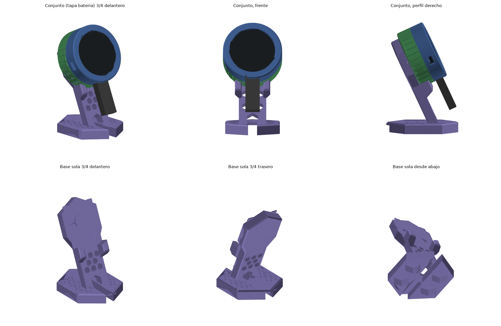
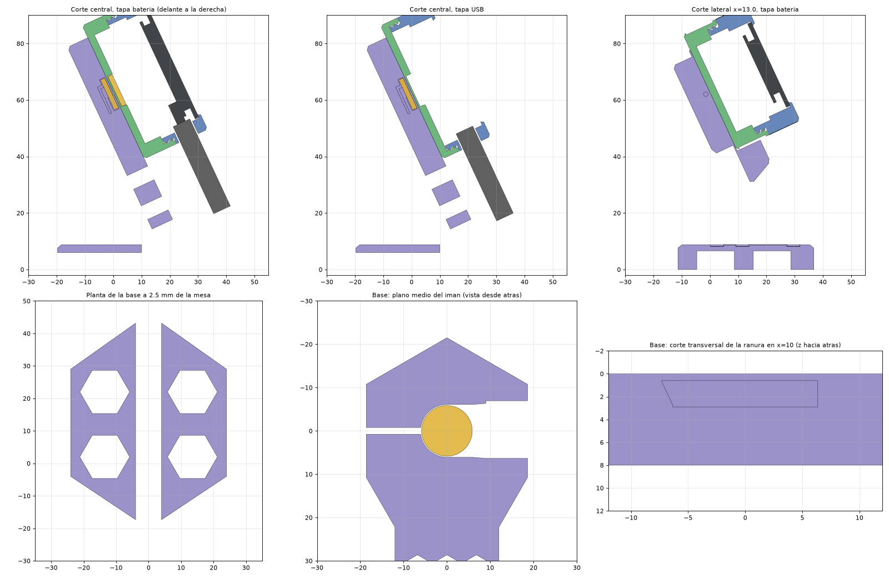

<div align="center">

**English** · [Español](README.md)

# Magnetic case for ESP32-2424S012 (1.28" round display) with charging stand

<br><sub>Model views</sub>

</div>

A round case for the **ESP32-2424S012** board (ESP32-C3 with a 1.28" round touch display), plus an industrial-style charging stand that makes the display look like it's floating.

The case attaches to the stand with a **hidden magnet** and leans back 25°. The USB-C port points down, so you can put the display on the stand and take it off again without unplugging the cable.

## Features

- **Two interchangeable screw-on back covers**:
  - **USB cover**: low profile, 18.7 mm total thickness, for always-plugged-in use.
  - **Battery cover**: with a chamber for an 802530 LiPo (~500–600 mAh), 24.7 mm total thickness.
- **Invisible magnets**: they sit behind 0.6 mm of plastic, so no glue shows.
  - In the cover, the magnet press-fits between 3 radial ribs. It's centered, so it works however the cover ends up rotated.
  - In the stand, the magnet slides in edge-first through a side slot. A flexible latch holds it by pressing on its flat face, never on its edge. An ejector hole lets you push it out with a pin.
- **Industrial-style stand**:
  - Hexagonal plinth with an engraved honeycomb pattern, and a hexagonal backplate that stays hidden behind the display.
  - V-jaws, like a machinist's V-block, that center the case.
  - Honeycomb cells cut all the way through.
- **Ballast from 4 M8 nuts** (DIN 934, 22 g) that slot in from underneath.
- **Cable exit** through a rear tunnel. A regular straight USB-C cable works.
- A side hole lets you reach the slide switch with a toothpick.
- **No supports needed**: the STLs are already oriented for printing.

## Parts

| File | Description |
|---|---|
| [`cuerpo.stl`](stl/cuerpo.stl) | Front ring with a lip for the glass, USB-C tunnel and thread |
| [`vaso_interior.stl`](stl/vaso_interior.stl) | Inner cup that holds the board against the lip and separates it from the battery |
| [`tapa_usb.stl`](stl/tapa_usb.stl) | Low back cover (USB only) |
| [`tapa_bateria.stl`](stl/tapa_bateria.stl) | Tall back cover with a battery chamber |
| [`base.stl`](stl/base.stl) | Tilted charging stand (48 × 63 × 82 mm) |
| [`probeta_iman_tapa.stl`](stl/probeta_iman_tapa.stl) | Fit test for the cover magnet (0.05 / 0.10 / 0.15 mm interference) |
| [`probeta_ranura_iman.stl`](stl/probeta_ranura_iman.stl) | Section of the backplate to test the stand's magnet slot and latch |

Print only the cover you'll use, or both.
The STLs are in [`stl/`](stl/); GitHub shows them in 3D when you open them.

## What you need

- 1 × ESP32-2424S012 board
- 2 × neodymium magnets, Ø11.7 × 1.7 mm (measured; look for 12 × 2 mm and check the fit with the test piece)
- 4 × M8 DIN 934 nuts (ballast)
- Optional: 1S 802530 LiPo battery with a protection circuit and a **1.25 mm JST connector** (not the 2.0 mm JST-PH)
- Optional: superglue, adhesive silicone bumpers

## Print settings

- Layer height 0.2 mm or lower, 3 perimeters.
- Stand: 15–20 % infill.
- **PETG** if you'll use the battery, since it handles heat better. PLA is fine for the USB version.
- **Print the two test pieces first** to check that your magnets fit. They're small and only take a few minutes.

## Assembly

1. Insert the board from the back of the front ring, display facing the lip and USB-C lined up with its tunnel.
2. Route the antenna through the slot in the inner cup and fit the cup: its notches engage the ribs in the ring and stop it from turning.
3. With a battery: plug it in through the window in the cup and rest it on top.
4. Press the magnet into the cover and screw the cover on.
5. Slide the stand magnet into its side slot until it clicks under the latch. **Before fixing it, check that the case and the stand attract each other.** If they repel, flip the magnet.
6. Push the 4 M8 nuts into their pockets on the underside.

With this repo's firmware, just **swipe vertically** on the screen to turn it 180°.

## ⚠️ Battery notes

- These connectors have **no standard polarity**. Use a multimeter to check that the battery's + matches the board's +.
- The IP5306 charger can deliver up to ~2 A, which is too much for a small cell. Until that's confirmed, charge from a computer USB port.
- The IP5306 usually shuts off its output at very low loads, so deep sleep may power the board down.

## Known limitations

- There's no access to the BOOT/RESET buttons and no opening for the 4-pin connector.
- The positions of the battery connector, switch and antenna were taken from photos. The openings have some margin, but check your first print.

## Parametric design

The model is built in code with **FreeCAD** (Python), in [`fuente/`](fuente/). Clearances, thread,
tilt and battery size are set with the constants at the top of `carcasa.py`.

```bash
cd fuente
freecadcmd carcasa.py          # front ring, inner cup and plain covers -> fuente/salida/
./iteraciones/run.sh it04      # industrial stand, magnet covers and test pieces -> iteraciones/it04/
```

`it04/diseno.py` reuses the dimensions of `carcasa.py` and replaces the stand and covers; `evaluar.py`
checks overhangs, interferences and wall thickness, and renders the views.
(Code comments are in Spanish.)

<div align="center"><br><sub>Cross-sections of the assembly</sub></div>

---

<div align="center"><sub>← Back to the [main project](../README.en.md)</sub></div>
